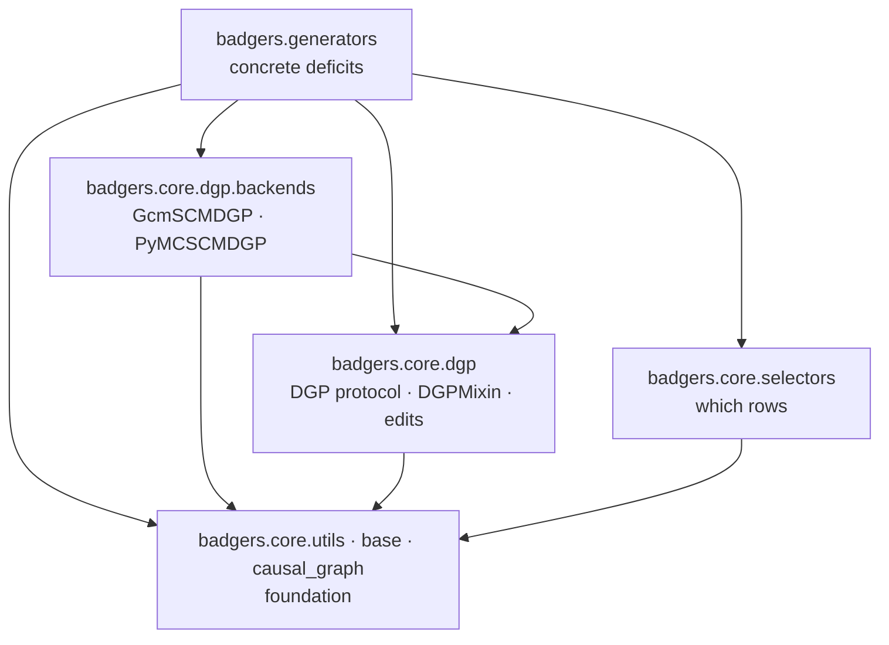

# Building blocks

The module map and the dependency rules between the blocks. The rules are enforced by
`import-linter` (see [Architecture](../architecture.md#what-is-enforced-not-just-documented)); the
descriptions are not.

## Module map

```
badgers/
├── core/                          # reusable, modality-agnostic foundation
│   ├── base.py                    # GeneratorMixin — the generate(X, **params) -> Xt contract
│   ├── pipeline.py                # Pipeline — chains generators sequentially
│   ├── utils.py                   # probability normalization, RNG helpers
│   ├── causal_graph.py            # DAG validation, topological descendant walk
│   ├── sampling.py                # OOD samplers (zscore, hypersphere, histogram, tree, ...)
│   ├── decorators/                # preprocess_inputs for tabular and time-series inputs
│   ├── selectors/                 # WHICH rows get a deficit (value-free / value-driven presets)
│   └── dgp/                       # HOW a causal model propagates a deficit
│       ├── protocol.py            # DGP protocol: fit_node / response / draw_noise
│       ├── base.py                # DGPMixin — generic sample / intervene / structural
│       ├── views.py               # read-only structural views
│       ├── edits.py               # structure edits as free functions
│       └── backends/              # GcmSCMDGP, PyMCSCMDGP (lazy imports)
│
└── generators/                    # concrete deficits, grouped by modality
    ├── tabular_data/
    │   ├── outliers/              # OutliersGenerator, OutlierSamplingGenerator, causal
    │   ├── noise/                 # AdditiveNoiseGenerator, causal
    │   ├── missingness/           # MCAR/MAR/MNAR, causal
    │   ├── drift/                 # drift generators, causal
    │   ├── imbalance/             # imbalance + multiplicity
    │   └── causal/                # CausalGenerator — shared base for causal generators
    ├── time_series/               # changepoints, missingness, noise, outliers, patterns,
    │                              # seasons, transmission_errors, trends
    ├── graph/                     # missingness
    ├── text/                      # typos
    ├── image/                     # stub
    └── geolocated_data/           # stub
```

## Dependency direction

Dependencies point **downward only**. A block may use the blocks below it and nothing above.



Note what is *absent*: `badgers.core` never points at `badgers.generators`, and
`badgers.generators` never points at `badgers.core.dgp.backends` — a generator receives a
backend by injection and cannot name one.

## The four contracts

Almost all of the design is captured by four small contracts. A generator is a *composition*
of them, not a reimplementation.

| Contract | Lives in | Question it answers |
|---|---|---|
| `GeneratorMixin.generate(X, **params) -> Xt` | `badgers.core.base` | What does a generator look like? |
| `Selector = Callable[[X, targets], dict[int, spec]]` | `badgers.core.selectors` | *Which* rows get the deficit? |
| `Sampler.sample(rng, X, columns, n)` | `badgers.core.sampling` | *What values* replace them? |
| `DGP.fit_node / response / draw_noise` | `badgers.core.dgp` | How does a causal model *propagate* it? |

### `GeneratorMixin`

```python
class GeneratorMixin:
    @abc.abstractmethod
    def generate(self, X, **params):
        """Return Xt."""
```

One method, one return value. Target-like data lives *inside* `X` (as a column, or as a graph
attribute) rather than being passed separately — this is what lets the same `Pipeline` chain
tabular, time-series and graph generators.

### `Selector`

A selector decides which rows of the input get a deficit. It returns a mapping from column
position to a per-row mask or score:

- keys = column positions (the columns the deficit applies to)
- values = boolean masks or float scores in `[0, 1]`
- polarity: `True` / `1.0` means *deficit applied*

Values restricted to `{0, 1}` are **decisions**; anything else is a **probability**. Two RNG
streams cooperate: the selector's own RNG drives the spec, the consumer's RNG drives the
realization with the single rule `rng.random(n) < spec`. `selector=None` means the consumer
decides.

There is deliberately **no base class and no registry** — conformance is defined by the call
signature alone.

### `Sampler`

Out-of-distribution value synthesis is owned by `badgers.core.sampling`, not by the generators.
`OutlierSamplingGenerator` resolves a registry name at `generate()` time via
`create_out_of_distribution_sampler`. Adding a strategy means adding a sampler, not a
generator. See [ADR-6](adr/0006-shared-ood-samplers.md).

### `DGP`

The causal contract is described in full on the [Causal defect family](causal-design.md) page.

## Adding a generator

1. Pick the modality package under `badgers/generators/`.
2. Subclass `GeneratorMixin`, decorate `generate` with the matching `preprocess_inputs`.
3. Reuse a selector for row choice and a sampler for value synthesis — do not inline either.
4. Export the class from the package `__init__.py`.
5. Add a test under `tests/generators/<modality>/` and a benchmark registration under
   `benchmarks/generators/<modality>/_<name>.py`.

Steps 1–4 must not require touching `badgers/core/`. If they do, the contract is missing
something — fix the contract, not the generator.
