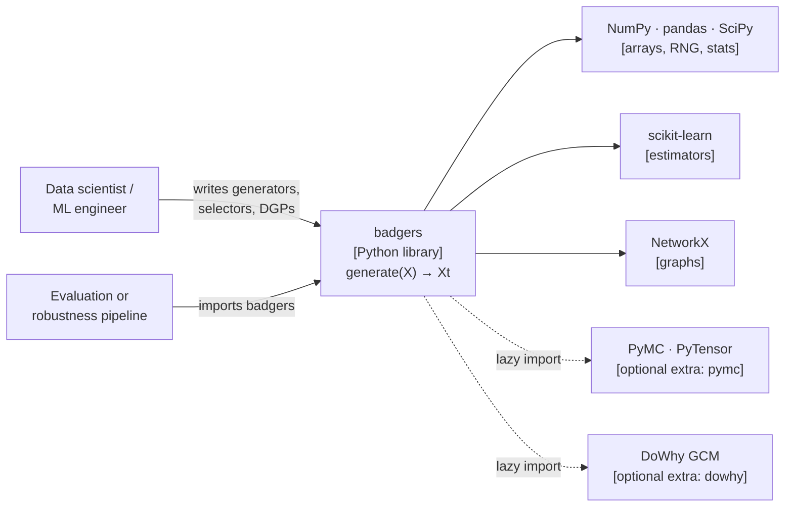

# System context

C4 level 1. `badgers` is a single Python library — there is no container level, no service
boundary and no deployment topology to describe. What matters is who calls it and what it
pulls in.

## Actors

| Actor | Interaction |
|---|---|
| **Data scientist / ML engineer** | Uses the shipped generators to inject deficits into a dataset, then measures the effect on a model or analysis. |
| **Generator author** | Subclasses `GeneratorMixin` and implements `generate`. See [Creating Tabular Generators](../tutorials/dev/Create-New-Tabular-Generators.ipynb). |
| **Causal modeller** | Supplies a fitted `DGP` (or wraps a DoWhy/PyMC model) and uses the causal generators. See [Using DGPs](../tutorials/dev/Using-DGPs.ipynb). |

## External systems

| System | Kind | Why it is there |
|---|---|---|
| NumPy | hard dependency | All data is handled as `numpy` arrays internally; the RNG is always caller-supplied. |
| pandas | hard dependency | Accepted as input and returned as output for tabular generators. |
| SciPy | hard dependency | Distributions used by noise and outlier samplers. |
| scikit-learn | hard dependency | Estimators used by drift detection and by the default DGP backend. |
| NetworkX | hard dependency | Graph structure for the causal generators and the graph missingness generator. |
| PyMC / PyTensor | optional extra `pymc` | One DGP backend (`PyMCSCMDGP`). |
| DoWhy GCM | optional extra `dowhy` | One DGP backend (`GcmSCMDGP`). |

The two optional backends are imported **lazily**, inside their own modules, via a PEP 562
`__getattr__` in `badgers.core.dgp.backends`. Importing `badgers` or `badgers.core.dgp` must
never pull them in — this is asserted by `tests/core/test_import_hygiene.py`.

## What badgers is *not*

- **Not a data-quality *detector*.** It injects deficits; it does not find them.
- **Not a scikit-learn transformer.** `badgers.core.pipeline.Pipeline` is deliberately not
  compatible with `sklearn.pipeline.Pipeline` — it chains generators, not estimators.
- **Not a data *generator* from scratch.** It augments existing data; the input `X` is always
  required.
