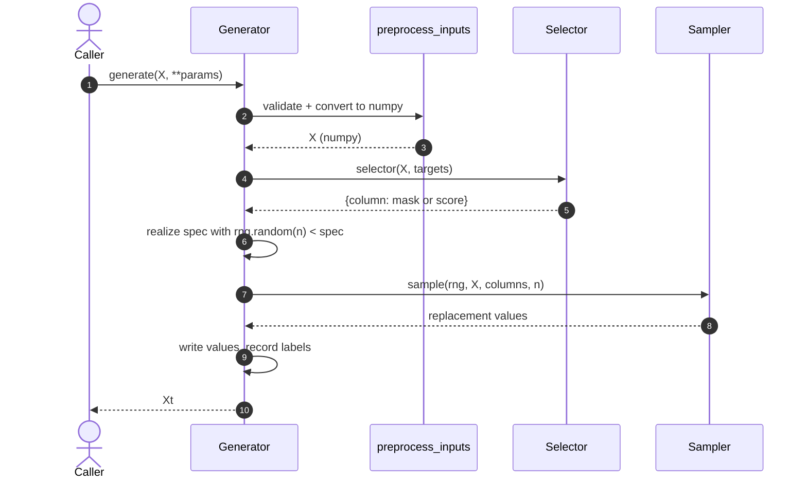
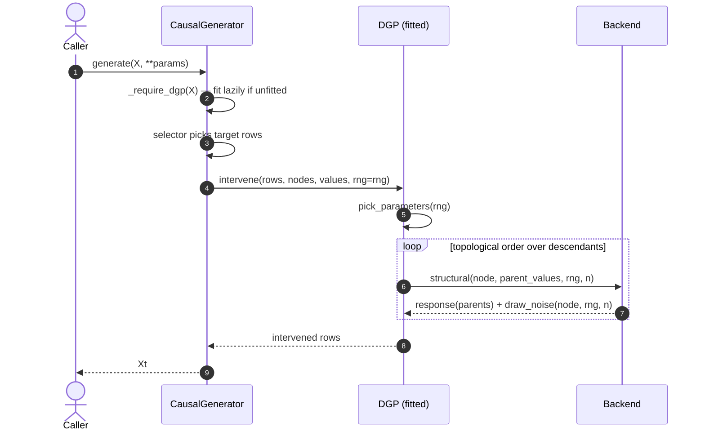

# Runtime scenarios

Two flows carry almost all of the runtime behaviour. Everything else is a variation on them.

## Scenario 1 — a plain `generate()` call

A non-causal generator: the selector picks rows, the sampler (or the generator itself) writes
new values, the output is returned.



Key properties:

- The RNG is **always caller-supplied**; no generator holds global state.
- `preprocess_inputs` is the only place that knows about pandas vs numpy.
- The generator records per-row labels (`get_outliers_labels()`, …) so the caller can score
  the effect of the deficit afterwards.

## Scenario 2 — a causal cascade

A causal generator does not invent values; it asks a fitted `DGP` to propagate an
intervention through the graph.



Key properties:

- The generator **never sees which backend ran**. Backend selection is object injection only
  (`dgp=...` in the constructor, or `use_dgp(dgp)`).
- A missing `dgp=` is a hard error — there is no implicit default backend.
- An unfitted DGP is fitted lazily on the first `generate(X)`. Fit it explicitly on clean data
  if the pipeline injects several deficits in sequence, otherwise the second generator fits on
  already-contaminated data.
- `pick_parameters(rng)` is the hook that lets a backend pin one coherent posterior draw per
  cascade (the PyMC backend overrides it; the default returns `self`).

## Scenario 3 — chaining generators

`badgers.core.pipeline.Pipeline` applies generators in insertion order, threading `Xt` into the
next `generate`:

```python
from badgers.core.pipeline import Pipeline

pipeline = Pipeline({
    "noise": AdditiveNoiseGenerator(random_generator=rng),
    "outliers": OutliersGenerator(random_generator=rng),
})
Xt = pipeline.generate(X, params={"noise": {"distribution": dist}})
```

`params` is keyed by generator name; a generator with no entry is called with no extra
arguments. The pipeline is deliberately **not** compatible with `sklearn.pipeline.Pipeline`.
